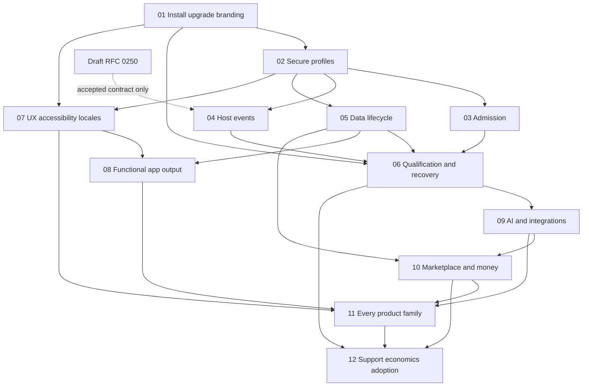

# Platform gap-closure plan — 2026-10-24

Status: **Proposed; complete for section-by-section review. Wave A's five changes are merged (see [Wave A progress](#wave-a-progress-2026-10-25)); every original gap stays Open, and Waves B–E wait for their accepted decisions.**

This plan closes the scope of the [dated competitive audit](../../research/platform-gap-analysis-2026-10-24.md), rather than replacing it with a narrower product brief. All **28 original gaps**, **8 live follow-up items**, **31 assessed categories**, and **229 source feature-directory rows** (144 unique directory names) are traced. There are **12 section PRDs, 69 requirements, 48 proposed behavioral witnesses, 38 planning questions and 25 risks**. Counting planned tests does not mean they have run. The separate upstream RFC adds five unresolved protocol questions and five risks; they are not included in the host counts.

## Intake summary

| Input | Status | Evidence / consequence |
| --- | --- | --- |
| User objective | Provided | Comprehensive fact-based closure plan, /prd per section, authored in order |
| App snapshot | Provided | 87719df6f; audit committed as f4f016704; source and original findings remain dated |
| Current upstream spec | Fetched | 10633f3c; v2 current, v1 frozen; RFC 0249 already allocated and refreshed to Active |
| App rules | Read | ARCHITECTURE/FEATURES/ROADMAP/CLAUDE, existing ADR owners and actual source |
| Method | Completed for planning | All five /prd roles applied sequentially to each of 12 sections: spec, schema, security, conformance and compatibility |
| Protocol scope | One Draft | [RFC 0250 upstream Draft](https://github.com/openwop/openwop/blob/97def7cf585e2c4f8b428b689a55bd3d5b8412cc/RFCS/0250-opt-in-host-event-replay-and-resync.md) + upstream gap/risk registers, optional host-event strict replay/resync |
| Host-only sections | Explicitly classified | Requirements remain host PRDs. UI, storage internals, release policy and commercial terms do not become normative protocol requirements |
| Architecture | Proposed | [ADR 0970](../../adr/0970-platform-competitive-gap-closure-program.md), extending existing owners/programs; no feature implementation |
| Market basis | Dated primary sources | [28-product landscape](../../research/deep-research-platform-2026-10-24.md); source limitations preserved; external claims reverify at implementation/procurement |
| Failing scenarios | Limited | Brand spinner/control limits were source-traced, not all reproduced; selected tests in audit passed. Plan starts with missing behavioral witnesses, not invented current test failures |
| Missing external inputs | Explicit | Staffing, supported workload/retention/RPO/RTO, independent assessor/participants, infrastructure/accounts/keys/budgets, native reviewers and support commitments |
| Source of truth | Traceable | [coverage.json](coverage.json), [requirements→witnesses](requirement-witness-map.json), [feature-census.json](feature-census.json), each section companion register |

The upstream /prd skill references frozen v1 paths and root-level registers; current corpus rules take precedence: normative changes target **spec/v2/**, and RFC registers live in **RFCS/registers/**. No missing archival PROTOCOL-GAP-CLOSURE-PLAN path is fabricated. Current ROADMAP and KNOWN-LIMITS supply protocol context.

## 1. Complete section sequence

Each section follows the RFC template's core order while remaining clearly labeled a host PRD, and has its own planning-gap/risk companions. They were authored one by one in this sequence; no sub-agents were dispatched for planning.

| Section | PRD | Original gaps | Proposed accountable role | Relative effort |
| --- | --- | --- | --- | --- |
| 01 | [Operator installation, upgrades and complete branding](01-operator-installation-upgrades-and-branding.prd.md) | OPS-01, OPS-02, OPS-04, BRAND-01 | Release engineering / operator experience | L |
| 02 | [Secure deployment profiles and independent assurance](02-secure-profiles-and-independent-assurance.prd.md) | SEC-01, SEC-02 | Security / identity engineering | L |
| 03 | [Distributed admission and resource budgets](03-distributed-admission-and-resource-budgets.prd.md) | SCALE-01 | Runtime / storage engineering | L |
| 04 | [Host-event durability, fan-out and resynchronization](04-host-event-durability-and-resync.prd.md) | EVENT-01 | Event runtime / storage engineering | L |
| 05 | [Data integrity, lease fencing and lifecycle completeness](05-data-integrity-leases-and-lifecycle.prd.md) | DATA-01 | Storage / data integrity engineering | L |
| 06 | [Release qualification, full recovery and measured reliability](06-release-qualification-recovery-and-slos.prd.md) | OPS-03, REL-01, QA-01 | Reliability / release qualification | XL |
| 07 | [Recoverable UX, accessibility, localization and first value](07-ux-accessibility-localization-and-first-value.prd.md) | UX-01, UX-02, UX-03, UX-04, UX-05, LOC-01 | Frontend experience / accessibility / localization | XL |
| 08 | [Functional app-builder output and governed deployment](08-functional-app-builder-and-governed-output.prd.md) | APP-01 | App-builder / generated-runtime engineering | XL |
| 09 | [AI outcome quality and maintained integration coverage](09-ai-outcomes-and-qualified-integrations.prd.md) | AI-01, INT-01 | AI platform / integrations engineering | XL |
| 10 | [Publisher lifecycle, marketplace trust and financial operations](10-publisher-marketplace-and-financial-operations.prd.md) | DEV-01, MKT-01, COM-01 | Marketplace / billing / developer experience | XL |
| 11 | [All product families, complete journeys and technical-debt census](11-all-product-families-and-technical-debt.prd.md) | FAM-01 | Product/domain engineering leads | XL |
| 12 | [Support commitments, unit economics and independent ecosystem evidence](12-support-economics-and-ecosystem-evidence.prd.md) | SUP-01, MKT-02, TCO-01 | Product operations / support / commercial sponsor | L plus elapsed customer observation |

S/M/L/XL describe relative scope only; they are not person-days, budgets or delivery dates. Roles are proposed accountability, not assigned staff. Risk registers propose a **2026-10-31 review checkpoint**, not promised mitigation completion. Exact staffing and schedule are explicit decision inputs.

## 2. Facts that change the implementation approach

1. **Do not rebuild solved primitives.** Run creation/outbox/idempotency, durable workspace gating, metrics, workflow environment pins, keyboard canvas edges, CDP identity/schema/activation and runtime Appearance are implemented. Older Proposed catalog rows can be stale; section 01 reconciles current claims to child evidence without rewriting history.
2. **Rate limiting already has several owners.** General middleware is process-local; sharedRateLimit already provides CAS-backed public-token fixed windows (ADR 0934); planRunLimit already owns monthly plan usage. Its documented fail-open/fork coverage needs actual caller verification. A new durable concurrency reservation extends existing run/storage ownership; it is not another generic billing ledger.
3. **Host-event transport is protocol-facing.** `/host/events` is RFC 0236, not the app's binding admin API. Storage/oversized-notification repair can ship under that contract. New explicit expired-cursor refusal/replay advert needs optional upstream semantics and therefore RFC 0250. Do not add an invented wire error in the app first.
4. **App-builder limitations are real and scoped.** Preview operation mocks, empty UI generator action/binding contract lists and 501 backend actions do not establish full functional applications. Preflight warnings already exist. Section08 implements the missing functional path, retaining ADR 0349's amendment gate for real deployment; disclosure alone does not close APP-01.
5. **Evidence is separate from implementation.** Source controls, self-measured conformance, code counts, syntactic UX cohorts and passing selected tests do not prove independent security, customer adoption, complete journeys, capacity or recovery.
6. **A full restore is more than a DB backup.** Database/schema metadata, objects, key/KMS access/rotation versions, config/identity/domain bindings, pack/runtime pins and actual operator procedure form one recoverable release.
7. **Dependency advisory matches are now verified as open.** GitHub API reports 28 alerts (4 high/18 medium/6 low), with two runtime and two toolchain high entries. [Inventory](dependency-alerts.json) and section02 record manifest/advisory/patch floor and focused regression. This is additional SEC-02 evidence, not a full reachability audit or proof of 28 exploitable defects. Triage/upgrade work enters wave A.
8. **All families stay in scope.** Section11 tracks128 backend +101 frontend directories, including disabled/BETA/vertical features. First-bundle prioritization cannot erase other rows. Its3,055 marker candidates require context classification; they are not3,055 confirmed defects.

## 3. Boundaries, reuse and design decisions

| Concern | Existing owner to extend | Decision |
| --- | --- | --- |
| Organizations/subjects/roles | accessControl, identity/session and protocolAuthorization | One authority; no onboarding-specific identity store |
| Security profile | deployPosture + existing deployment preflight | Versioned production/evaluation profile with migration and no-lockout fixtures |
| Quotas | sharedRateLimit, planRunLimit, existing run creation/Storage/outbox | Separate traffic windows, entitlements and durable active-run admission; review shared atomic transition API |
| Events | host event dispatcher/stream and Storage/pubsub | Durable refs/log through current owner; ephemeral remains unpersisted |
| Data lifecycle | Feature-owned stores, CAS/transactions, erasure/lifecycle registries | Fencing/constraints per actual invariant; no global mutex or shadow DB |
| Observability/evidence | OTel, Operations, CI/release/attestation and current ledgers | Reuse measurements/claims; do not create another operational truth |
| AI/workflow | One chat, agent/node packs, existing evals, chain/stack loader/executor | Every model exchange grounded; no second chat or hardcoded workflow system |
| Branding | Appearance/systemBrand/BrandProvider, native shell identity | Complete config/handoff and first paint; no replacement theming store |
| App generation | AppDoc, chassis, capability manifests, generators and export lineage | Functional parity and approved-hash deploy through existing architecture |
| Integrations | Connections/provider catalog/broker and current pack loader | Live qualification and maintenance; no extra credential vault |
| Marketplace/money | Registry/packTrust/listings, one Stripe client/webhook, billing/Connect/obligations | Preserve approvals, CAS money truth, two webhook secrets and all entitlement lanes |
| UX/locales | Shared Modal/Notice/StateCard/announcer/nav/tokens/i18n | Runtime failure/AT verification; no parallel per-feature widget sets |

Options were weighed within each section. The dominant force is a single authoritative owner with observable failure behavior. Optional flags can stage product features, but core tenant isolation/security/money correctness is never an experiment toggle. If a new host-internal schema is needed, its single owner, tenant indexing, erasure, atomicity and migration belong in the section decision before implementation.

## 4. Execution roadmap and concrete first changes

This is a dependency graph, not a repository-wide freeze or a requirement to finish every prior section before starting another. Section dependency lists mean **the relevant contract or test input is available**, not that all evidence in that section is closed. In particular, independent audit completion and 28 elapsed SLO days do not block a safe UI fix or test-harness development.

| Wave | Work | Entry / exit | Independent work that can proceed |
| --- | --- | --- | --- |
| A — reproduce/correct known defects | OPS-01/02, UX-01, branding docs/config mapping | Reproduce current behavior; focused corrections + affected gates + dated evidence | Secure-profile specification, real-DB fixtures, census, independent audit procurement/assignment |
| B — authoritative runtime safety | SEC-01, SCALE-01, DATA-01, EVENT-01 internal repair | Accepted host decisions; real concurrency/fault witnesses; compatible migration/rollout | UX cohort/native review, connector fixtures, full recovery runbook inventory |
| C — repeatable supported release | OPS-04, QA-01, OPS-03, REL-01 infrastructure qualification | Extracted bundle install→upgrade→restore, real Postgres, crash/effect/failover/load evidence | Begin28-day SLIs on qualified baseline; independent audit/retest and cross-host exchange |
| D — complete product/extension journeys | UX-02–05/LOC-01, APP-01, AI-01, INT-01, DEV/MKT/COM | Every declared operation/target/family requirement implemented and demonstrated | Domain families execute in risk-ordered waves; unknowns become refined PRDs, not silent omissions |
| E — external and commercial proof | SEC-02, SUP-01, MKT-02, TCO-01 and remaining REL evidence | Independent/elapsed/customer evidence plus approved staffed commitments | Regrade each category only as its closure packet becomes complete |

Strict host-event opt-in is a separate protocol train: Draft0250 → review/window → Active corpus work → implementation/conformance/SDK evidence → Accepted under upstream governance; host advertisement follows the app's accepted-RFC gate. No host release hold is imposed on unrelated work. No waiver or maintainer approval is invented.

### First independently reviewable implementation changes

| Change | Concrete scope | Required witness |
| --- | --- | --- |
| A1 | README Stripe/BYOK/fee-config examples and actual mounted-route recipe fixture | Current write works; retired spelling fails as expected; no real secret needed |
| A2 | releases.json0.2 compatibility correction, release-metadata validation and source→target upgrade planner | Known incompatible crossing requires stop; skip-version plans include every required action |
| A3 | BrandPage request-state/retry repair using existing StateCard/Notice | Failed first read terminates spinner; success/failure/disabled/stale/race cases |
| A4 | Appearance/runtime versus build/native config guide + Compose supported setting forwarding | First-paint/login/title/favicon/theme/native matrix and explicit ignored-variable refusal |
| A5 | Triage all 28 reported dependency alerts; patch compatible resolutions for four highs first, then remaining affected manifests | Advisory/lockfile/exposure proof, package-specific integration/build regressions and a rechecked alert/exception record |
| B1 | Accepted secure-profile decision and startup/preflight matrix | Missing control refused, valid evaluation profile preserved, recovery/no lockout tested |
| B2 | Real Postgres two-process admission/fault fixtures; existing run-lane census | Reproduce >60s local slot loss and cross-instance limits; no pg-mem concurrency proxy |
| B3 | Existing host event storage/ref publication repair | Large event A→B and fresh-process retained replay; ephemeral remains absent |

A test reading docs/research, docs/steward or .github belongs in backend/typescript/test/steward per distribution rules. Recipe checks that need stripped sources must run against the extracted bundle and cannot require files intentionally stripped from adopters. No application code changes or these future tests were executed by writing this plan. GitHub alert inventory was read through the API at final verification; no upgrade was applied.

### Wave A progress (2026-10-25)

This records what merged and which witness actually ran. A merged change is not a closed gap: no original ID below moves from Open, and no category grade changes, until its closure packet (section 5) is complete. Each requirement's full status, including what stays open, is in [requirement-witness-map.json](requirement-witness-map.json).

| Change | Requirement / gap | Merged | Witness that ran | Still open | Gap |
| --- | --- | --- | --- | --- | --- |
| A1 operator docs name live routes | S01-R1 / OPS-01 | #5184, f8b5ac251 | S01-T1 in-process, memory storage, fake credentials: `backend/typescript/test/operator-doc-routes.test.ts` (sabotage-witnessed) | Plan-config recipe; run against an extracted bundle; FEATURES/ROADMAP reconciliation (S01-R6) | Open |
| A2 upgrade planner + rolling-safety metadata | S01-R2 / OPS-02 | #5185, 6114d882d | S01-T2 metadata half: `backend/typescript/test/upgrade-plan.test.ts` (all 28 published pairs plan; 0.2.0 contradiction caught) | Boot guard against an older binary on a non-rolling-safe schema (ADR 0052 §D2a); real-DB migrations (S01-R5); supported-path decision (S01-G1) | Open |
| A3 Brand first read ends recoverably | S07-R1 / UX-01 | #5186, 8d8084242 | S07-T1 in jsdom: `frontend/react/src/features/brand/__tests__/brandFirstRead.test.tsx` (sabotage-witnessed) | Unmount case not observable; real browser and assistive-technology check (S07-T2/T3) | Open |
| A4 brand build variables are one checked set | S01-R3 / BRAND-01 | #5191, e5e38109d | S01-T3 config half: `frontend/react/src/brand/__tests__/brandEnvHandoff.test.ts` (real Vite build refuses a misspelled name) | First paint before the identity fetch, email and native-shell identity; compose image not built | Open |
| A5 dependency advisories | S02-R4 / SEC-02 | #5192, a29b98710 | No plan witness: S02-T3/T4 do not cover advisory triage. Measured instead: `npm audit --package-lock-only` before/after (27 of 28 rows cleared); GitHub re-check 2026-10-25 shows one open alert, #222 msal-node (high, excepted to 2026-11-07, unfixed) | msal-node fix; exploitability records; SBOM/license/provenance for images and desktop/iOS shells; secret-canary review | Open |

Found during Wave A, outside the plan's requirements: money exponents came from `Intl`, which on ICU 78 shows 0 decimals for 15 currencies ISO 4217 gives 2 (IQD 3). #5211 (f2f4a81cf) and #5213 (abe1f17d4) make every backend and frontend exponent read one ISO 4217 table, held by `backend/typescript/test/currency-iso-table-parity.test.ts`. A read-only production count on 2026-10-25 found 0 stored rows in those currencies across the seven money collections, so no migration was needed (probe: `scripts/currency-exponent-drift-probe.sql`). The ADR 0970 status correction (#5188, 30aabd811) also landed in Wave A.

Next: Wave B starts only with B1's accepted secure-profile decision (S02-G1); B2/B3 need their own decisions and real-Postgres fixtures. Section 04 follows RFC 0250's upstream governance, not this plan.

### Dependency view

Arrows carry the relevant design/fixture contract; they do not impose a whole-section completion hold.

## 5. Coverage and closure contract

[coverage.json](coverage.json) maps every original ID and category; [feature-census.json](feature-census.json) maps every directory; [requirement-witness-map.json](requirement-witness-map.json) maps all 69 requirements to proposed witnesses. A witness row may cover several related requirements; detailed cases are expanded by the implementer without dropping the requirement. The original assessment and each existing specialized tracker retain their history.

Each original gap stays **Open** until its packet contains:

1. Exact source/artifact/config/data-fixture/model/pack versions and affected scope.
2. Original reproduction or baseline and actual remediation; evidence-only gaps need the actual external/elapsed measurement.
3. Relevant positive, negative, tenant/role, replay/effect, failure/recovery and migration witnesses with the actor that can cause each condition.
4. Results classified executed-pass, executed-fail, skipped, inapplicable or blocked; blocked cannot count as pass. A lack of external participants/accounts/keys remains explicit.
5. Review of residual risk, rollback/restore path, owning ADR correction and any accepted RFC dependency; no stale claims/status.
6. Approved user/operator docs, current availability/qualification labels and meaningful regrade with confidence. A narrow support profile can be stated truthfully but does not erase broader original gaps.

No category is promoted to A from planning, generic green checks or renaming scope. No realistic plan can guarantee customer adoption or favorable economics; MKT-02/TCO-01 close through real observations and any resulting product work. Qualify all existing offered families; discovery can find additional gaps, which inherit full PRD/owner/acceptance/refinement discipline before closure.

## 6. Decision and input register

Full questions live in section `.gaps.md` files. These cross-program decisions are critical:

| Decision | Proposed accountable role | Evidence required | Blocks |
| --- | --- | --- | --- |
| Production tier/workload/control profile and migration support | Release + security + product owners | Current operator/customer commitments and real deployment constraints | Strict rollout and supported claims, not safe docs/UI fixes |
| Budget counting states, failure posture and atomic admission design | Runtime/storage/billing owners | Lane census, real DB races and availability requirements | Hard-quota implementation semantics |
| Retention/privacy exceptions, replay order and baseline resync | Event/storage/privacy owners + upstream maintainers | RFC 0250 review and causable witnesses | Strict protocol contract/advertisement |
| Functional generated-app stack and first deploy adapter | App-builder + infrastructure/security owners | Existing0348/0349 decision amendments and isolated target | Live/generated backend/deploy phase, not target census |
| Capacity/SLO/RPO/RTO pass thresholds | Reliability + customer/product owners | Declared objectives mapped to supported workload and recovery requirements | Honest qualification verdict |
| Independent audit, testers, native reviewers, external pilots | Sponsor + functional leads | Assigned people, accounts, consent and scope | Relevant human/independent closure |
| Vendor/model/provider keys and spend | User/sponsor + AI/integration owner | Explicit named vendor/key/budget instruction at execution | Paid live qualification; not local fixture authoring |
| Support/LTS/security escalation commitments | Actual staffed commercial/security owners | Coverage, costs, compatible prior terms and rehearsal | Published commitments |

Resolve through recorded decisions; do not infer answers from time passing, nonexistent user approval or a Draft status. All38 section questions have a proposed owner, resolution path and blocking gate. All25 risks have likelihood/impact, mitigation, proposed owner and checkpoint; none is reported mitigated merely by being listed.

## 7. Resource and schedule model

Workstreams need release/infrastructure, runtime/storage, identity/security, frontend/accessibility/localization, app-builder, AI/integrations, marketplace/billing and product/domain expertise, plus independent assessors/operators/users. These are roles, not a headcount claim. Confirm available staffing and test budgets, then estimate each section's concrete implementation slices from current code/prototypes. Do not turn L/XL into unsupported calendar promises.

Elapsed external dependencies are explicit: real 28-day SLI observation, governance windows/approval for protocol changes, provider accounts/rate limits, independent audit/retest and participant availability. Begin provisioning, metric baseline and reviewer assignment alongside independent repository changes. Never create a global branch/deployment freeze to wait for them.

## 8. Verification and release controls

Implementation uses canonical frontend `npm run build`, affected backend/frontend behavior tests, and full applicable `npm run ci`/merge-train gate. Real Postgres/fault/restore qualification is mandatory for the sold profile even where generic CI keeps Docker optional. No bare Vite substitute; no forced Tracegate enforce or deleted ledgers. New data schemas use contiguous migrations and release classification; feature toggles gate availability, not historical pack presence or core safety.

Deploy changed backend first, wait for serving revision, then frontend. Deploy clean current origin/main through existing checks; preserve live secret/env bindings with incremental updates. Verify exact serving revision/bundle, readiness, streaming and the affected journey. Release attestations bind actual artifact/config/profiles; other sessions continue using isolated worktrees and advisory queues.

This planning turn validates document links, coverage/counts, dependency graph, RFC structure/register placement and diagram parsing/status consistency. It does not rerun application CI, execute cloud/provider/customer work, perform pen tests or close original gaps. The prior audit's57 selected passing tests remain prior evidence, not a new full-suite pass.

## 9. Architecture review and GO / NO-GO

Track A applies to all host sections; Track B additionally applies to section 04/RFC 0250. No duplicate chat, identity, credential, payment, workflow, registry or data authority is proposed. Proposed new admission/log state belongs to existing owners and has explicit schema/tenant/erasure/atomicity/compatibility work. Boundary table and per-section five-pass findings are the review record; this is not a claim of independent architect approval.

**GO:** complete Proposed planning package and start independent reproduction/docs/UI/test-fixture work once assigned. **CONDITIONAL:** non-trivial implementation waits for its specific accepted architectural decision, required inputs and meaningful failure tests. **NO-GO:** advertise Draft0250, claim independent security/SLO/marketplace success, publish unstaffed support promises, or mark any original gap closed from this plan alone.

No critical intake is fabricated to obtain an Accepted label. No new protocol requirement is slipped into host-only PRDs. The scope remains all original gaps and all inventoried families, delivered through explicit dependencies and measurable gates.

## Sources

- [Original assessment](../../research/platform-gap-analysis-2026-10-24.md) and [official market scan](../../research/deep-research-platform-2026-10-24.md).
- Current source/ADR references are in each section; worktree source snapshot is 87719df6f.
- [WCAG2.2](https://www.w3.org/TR/WCAG22/) and [WAI modal pattern](https://www.w3.org/WAI/ARIA/apg/patterns/dialog-modal/), verified 2026-10-24, inform section 07's proposed accessibility checks.
- [PostgreSQL isolation](https://www.postgresql.org/docs/current/transaction-iso.html), verified 2026-10-24; qualify the deployed DB major and isolation level rather than assuming read-committed makes all multi-row invariants serializable.
- [WHATWG SSE](https://html.spec.whatwg.org/multipage/server-sent-events.html), verified 2026-10-24; transport reconnect behavior does not itself supply persistent host replay.

## Changelog

- 2026-10-25: Wave A progress table: A1–A5 merged (#5184, #5185, #5186, #5191, #5192) with the witnesses that ran and what stays open; all original gaps still Open.
- 2026-10-24: Authored 12 sections sequentially with all five /prd passes; original-gap/category/feature and requirement/witness maps; one proposed app ADR and one upstream Draft RFC with proper registers. All implementation/evidence closure remains open.
